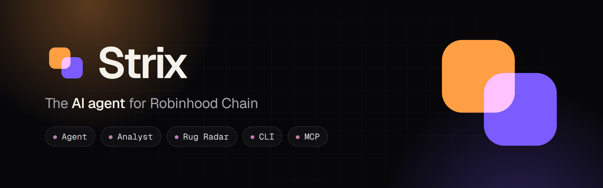
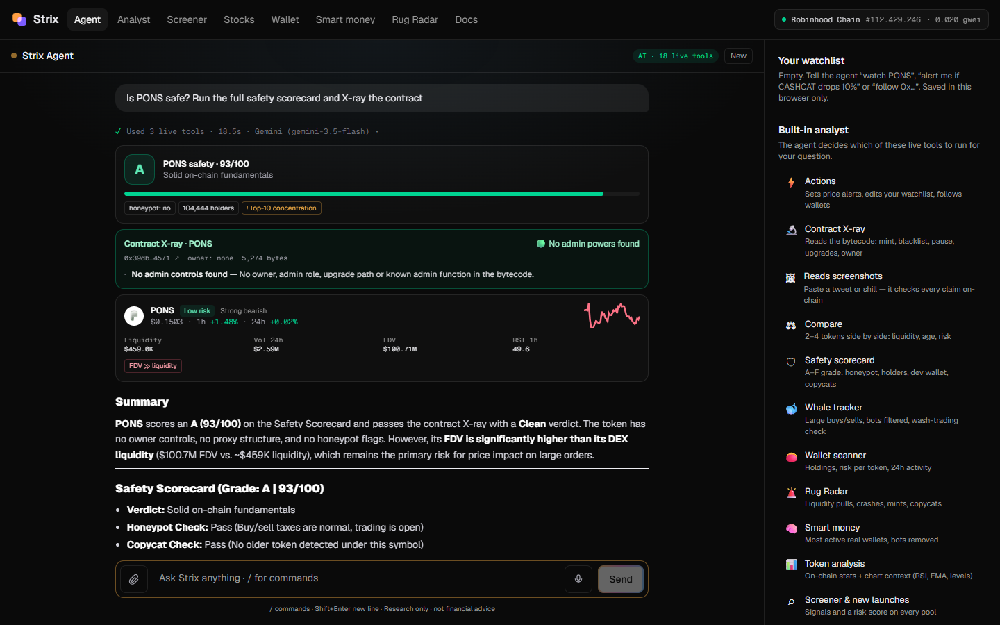
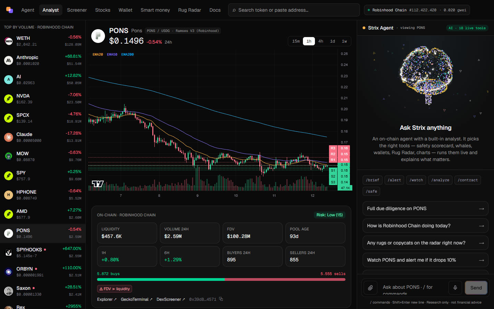
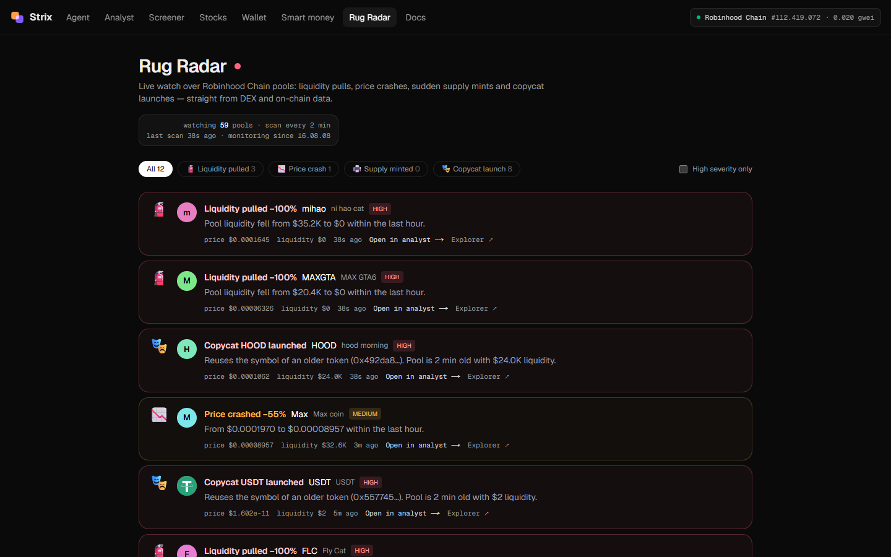

<p align="center"></p>

<p align="center">
  <a href="https://strixagents.com"></a>
  <a href="LICENSE"></a>
  
  
  
  <a href="https://x.com/strix_agents"></a>
</p>

<p align="center">
  <b>The AI agent for Robinhood Chain.</b><br>
  Ask in plain English — Strix runs live on-chain tools, checks the rug risk and explains what it finds.<br>
  In your browser, your terminal and any MCP client.
</p>

<p align="center">
  <a href="https://strixagents.com/agent"><b>Try the agent</b></a> ·
  <a href="https://strixagents.com/docs"><b>Docs</b></a> ·
  <a href="#cli"><b>CLI</b></a> ·
  <a href="#mcp-server"><b>MCP</b></a> ·
  <a href="https://x.com/strix_agents"><b>X / Twitter</b></a>
</p>

<p align="center"></p>

> Research tool only — Strix explains data and risk, it never tells you what to buy or sell. Nothing here is financial advice.

## Why Strix

Robinhood Chain moves fast: new pools every hour, copycat tokens reusing famous symbols, tokenized stocks trading 24/7. Explorers and DEX screeners show you raw numbers — Strix **reads them for you**.

- 🧠 **An agent, not a dashboard.** It decides which of its live tools to run (18 of them), chains them, and explains the result with data cards you can click.
- 🔬 **Contract X-ray.** Reads token bytecode straight from the chain: can the owner mint, blacklist wallets, pause, change taxes, switch trading off or swap the code behind a proxy? Is ownership renounced?
- 🚨 **Rug Radar.** A background watcher over the top, trending and newest pools: liquidity pulls, price crashes, sudden supply mints and copycat launches.
- 🖼️ **Reads screenshots.** Drop in a tweet or Telegram shill — it reads the tokens, addresses and claims, then checks each one against real chain data.
- ⚡ **Acts for you.** “Alert me if PONS drops 10%”, “watch CASHCAT”, “follow 0x…”, `/brief` for a personal briefing.
- 🧾 **Real data only.** Every number comes from a live source — no sample or demo data.

## Features

| | |
|---|---|
| **Agent** · [`/agent`](https://strixagents.com/agent) | Streaming answers, live data cards, slash commands, follow-up questions, voice input, chat history |
| **Safety scorecard** | A–F grade from honeypot status, copycat check, liquidity, pool age, holders, top-10 concentration, dev holding, wash trading, whale flow and the Contract X-ray |
| **Contract X-ray** | Bytecode selector scan for admin powers; EIP-1967 / beacon / EIP-1167 proxy detection with the upgrader; owner and renounce check; issuer assets (stock tokens, stablecoins) recognised |
| **Rug Radar** · [`/radar`](https://strixagents.com/radar) | Liquidity pulls, crashes, supply mints from chain logs, copycat launches — scanned every 2 minutes |
| **Analyst** · [`/app`](https://strixagents.com/app) | Candlestick chart with EMA 20/50/200 and support/resistance, on-chain stats, whale flow, price alerts — agent docked beside the chart |
| **Wallet scanner** · [`/wallet`](https://strixagents.com/wallet) | Holdings with risk per token, fake-airdrop filter, 24h buys and sells, bot / relayer detection |
| **Smart money** · [`/smart-money`](https://strixagents.com/smart-money) | Real wallets ranked by ~24h PnL, volume or activity — bots removed, automated wallets labelled |
| **Stock tokens** · [`/stocks`](https://strixagents.com/stocks) | Official Robinhood stock tokens vs the real share price — premium or discount, lookalikes flagged |
| **Screener** · [`/screener`](https://strixagents.com/screener) | Top, trending and new pools with signals and a risk level on every row |
| **Spoof detection** | Copycat symbols, impossible liquidity figures and names hiding invisible Unicode (fake “USDT”) are flagged |

<table>
  <tr>
    <td width="50%"></td>
    <td width="50%"></td>
  </tr>
  <tr>
    <td align="center"><sub>Analyst — chart, on-chain stats and the agent side by side</sub></td>
    <td align="center"><sub>Rug Radar — live red flags across the chain</sub></td>
  </tr>
</table>

## CLI

The CLI uses the hosted Strix at [strixagents.com](https://strixagents.com) by default — nothing to run.

```bash
git clone https://github.com/strixagents/Strix
cd Strix && npm install && npm link    # installs `strix` and `strix-mcp`

strix ask "Is PONS safe?"
strix contract CASHCAT                 # Contract X-ray
strix compare PONS NVDA                # side by side
strix radar                            # Rug Radar
strix wallet 0x…                       # holdings, risk, 24h trades
```

All commands: `ask` `overview` `analyze` `safe` `contract` `compare` `whales` `scan` `new` `stocks` `wallet` `search` `radar` `smart` `news` — add `--json` for scripts. Set `STRIX_URL` to point at your own server.

## MCP server

Give Claude Code (or any MCP client) Strix's read-only tools. After `npm link`:

```json
{
  "mcpServers": {
    "strix": { "command": "strix-mcp" }
  }
}
```

14 tools: `analyze_token`, `get_token_scorecard`, `scan_contract`, `get_whale_activity`, `scan_wallet`, `get_rug_radar`, `get_smart_money`, `compare_tokens`, `get_chain_overview`, `scan_tokens`, `get_new_launches`, `search_token`, `get_stock_premiums`, `get_news`.

## HTTP API

```bash
curl "https://strixagents.com/api/contract?token=PONS"

curl -X POST https://strixagents.com/api/tool \
  -H "content-type: application/json" \
  -d '{"name":"get_token_scorecard","args":{"token":"PONS"}}'
```

Endpoints, rate limits and the streaming agent API are documented at [strixagents.com/docs](https://strixagents.com/docs#api).

## Data sources (all free)

| Source | Used for |
|---|---|
| **Robinhood Chain RPC** | Blocks, gas, balances (Multicall3), transfer and mint logs, contract bytecode — with a DNS-over-HTTPS fallback when an ISP blocks the RPC |
| **GeckoTerminal** | Pools, candles, trades, holders, token info |
| **DexScreener** | Live pair prices and search |
| **Yahoo Finance** | Real share prices for the stock-token comparison |
| **Google News RSS** | Headlines |
| **Groq · Google Gemini** | AI reasoning (free tiers); Gemini also reads screenshots |

## Run it yourself

```bash
git clone https://github.com/strixagents/Strix
cd Strix
npm install
cp .env.example .env.local
npm run dev -- -p 3001                 # http://localhost:3001
```

| Variable | Needed for | Free key |
|---|---|---|
| `LLM_API_KEY` | AI answers (Groq) | [console.groq.com/keys](https://console.groq.com/keys) |
| `GEMINI_API_KEY` | Backup AI + reading screenshots | [aistudio.google.com/apikey](https://aistudio.google.com/apikey) |
| `COINGECKO_API_KEY` | Faster charts (optional) | [CoinGecko Demo plan](https://www.coingecko.com/en/api/pricing) |

Without any key Strix still runs on live data — the agent answers in rule-based mode. Deploys to [Railway](https://railway.com) as-is (`railway.json` included).

## Stack

Next.js 16 · React 19 · TypeScript · Tailwind CSS 4 · lightweight-charts · Model Context Protocol SDK — no blockchain library: ABI encoding, Multicall3 and Keccak-256 are implemented in a few hundred lines.

## Contributing

Issues and pull requests are welcome — read [CONTRIBUTING.md](CONTRIBUTING.md) first (real data only, free APIs, no buy/sell calls). Security issues: see [SECURITY.md](SECURITY.md).

## License

[MIT](LICENSE) © 2026 Strix Agents
